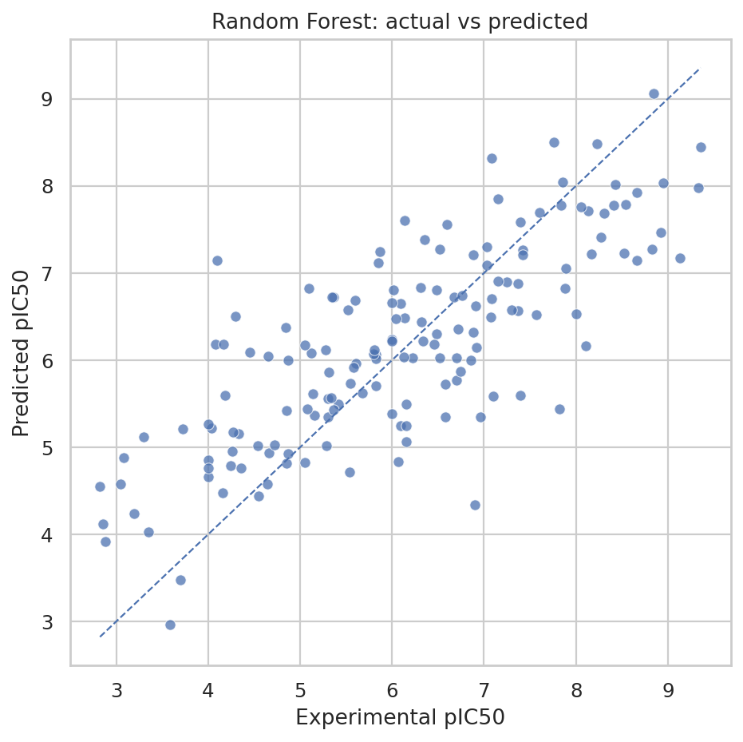
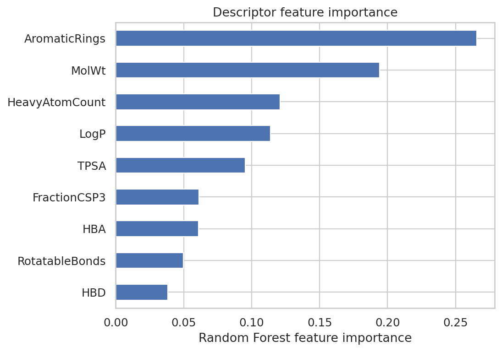
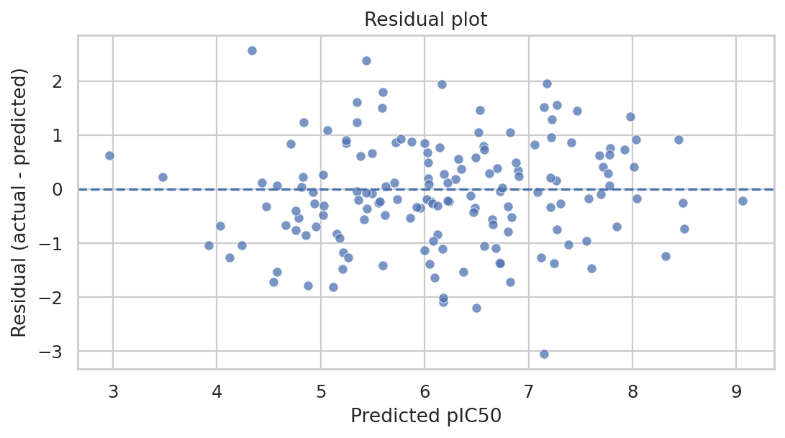

# EGFR Bioactivity Prediction

A machine learning project to predict the bioactivity of compounds against the Epidermal Growth Factor Receptor (EGFR) using ChEMBL data, RDKit and Random Forest regression.

## Project Overview

This project explores the relationship between molecular structure and biological activity using computational drug discovery techniques.

The target protein is EGFR (ChEMBL ID: CHEMBL203). Experimental IC50 measurements are converted into pIC50 values and used to train and evaluate machine learning models.

## Dataset

- Data source: ChEMBL
- Target: EGFR (CHEMBL203)
- Activity endpoint: Exact IC50
- Original activity records processed: 1,000
- Unique compounds after cleaning: 777
- SMILES: Used to represent molecular structures

**Note:** This project uses a 1,000-record subset of the available ChEMBL activity data.

## Methodology

1. Retrieve EGFR bioactivity data from ChEMBL.
2. Clean the activity data and remove duplicate compounds.
3. Convert IC50 values from nM into pIC50.
4. Generate molecular descriptors using RDKit.
5. Generate Morgan molecular fingerprints.
6. Train Random Forest regression models.
7. Evaluate model performance using R², RMSE and MAE.

## Important scientific caveats


## Model Performance

Two Random Forest regression models were evaluated using a held-out test set.

| Model | R² Score | RMSE | MAE |
|---|---:|---:|---:|
| RDKit Descriptors | 0.5993 | 0.9799 | 0.7789 |
| Morgan Fingerprints | **0.7595** | **0.7591** | **0.5763** |

### Key Findings

- Morgan fingerprints achieved the best overall performance.
- The Morgan fingerprint model produced lower RMSE and MAE.
- Molecular fingerprints provided better predictive performance than the RDKit descriptor baseline in this experiment.

*Note: These are baseline results from a held-out random test split, not external or scaffold-based validation.*
---

## Model Visualisations

### 1. Actual vs Predicted pIC50

This plot compares the actual experimental pIC50 values with the values predicted by the Random Forest model.



### 2. Molecular Descriptor Feature Importance

This visualisation highlights the molecular descriptors that contributed most to the RDKit-based Random Forest model.



### 3. Residual Analysis

The residual plot helps assess prediction errors and identify patterns in the model's deviations.



---

## Model Performance Summary

The Morgan fingerprint model achieved the best performance among the two evaluated approaches.

| Metric | RDKit Descriptors | Morgan Fingerprints |
|---|---:|---:|
| R² | 0.599 | 0.760 |
| RMSE | 0.980 | 0.759 |
| MAE | 0.779 | 0.576 |

8. Compare both modelling approaches.

## Model Performance

Two modelling approaches were evaluated:

| Model | R² | RMSE | MAE |
|---|---:|---:|---:|
| RDKit Descriptors | 0.599 | 0.980 | 0.779 |
| Morgan Fingerprints | **0.760** | **0.759** | **0.576** |

Morgan fingerprints achieved the best performance on the test split, with an R² of 0.760 and an RMSE of 0.759.

## Project Structure

```text
EGFR-Bioactivity-Prediction/
├── EGFR_Bioactivity_Prediction.ipynb
├── README.md
├── requirements.txt
└── results/
    ├── egfr_cleaned_bioactivity.csv
    ├── model_comparison.csv
    ├── run_summary.json
    ├── actual_vs_predicted.png
    ├── descriptor_importance.png
    └── residual_plot.png
```

## Results and Visualisations

The `results/` directory contains:

- Cleaned bioactivity dataset.
- Model comparison metrics.
- Run summary in JSON format.
- Actual vs predicted pIC50 plot.
- RDKit descriptor feature importance plot.
- Residual analysis plot.

## Technologies Used

- Python
- Google Colab
- ChEMBL
- RDKit
- Pandas
- NumPy
- Matplotlib
- Seaborn
- Scikit-learn

## Limitations

- The dataset represents a subset of available ChEMBL records.
- Experimental bioactivity measurements may vary across assays.
- Random train-test splitting does not guarantee generalisation to structurally novel compounds.
- Model predictions are computational estimates and require experimental validation.

## Future Improvements

- Expand the dataset using additional ChEMBL records.
- Apply scaffold-based train-test splitting.
- Explore additional machine learning algorithms.
- Perform hyperparameter optimisation.
- Validate predictions using external datasets.

## Disclaimer

This project is intended for educational and research purposes. The models are baseline computational tools and should not be used as a substitute for experimental validation or clinical decision-making.
